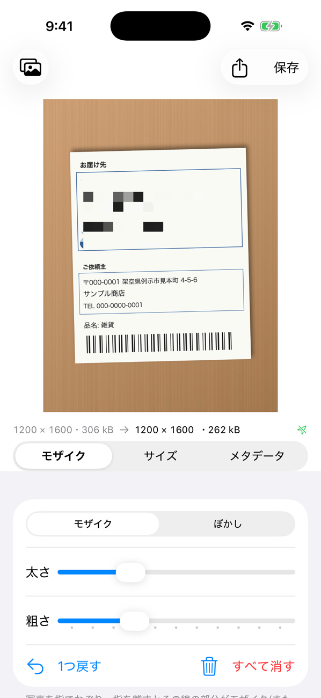

# Pixwash

写真を人に送る・載せる前の下ごしらえを1つにまとめた iOS アプリ(SwiftUI)。App Store では配布せず、無料の Apple ID(Personal Team)で手元の iPhone に入れて使う。



(写真は架空の伝票。名前・住所・電話番号はすべて架空のもの)

## 主な機能

アプリを開くと編集画面が出て、写真の場所の「写真を選ぶ」から写真を選ぶ。設定は写真を選び直しても引き継ぎ、次にアプリを開いたときも最後に使った設定で始まる。

- **拡大**: 2本指でピンチして拡大・移動できる(塗りは1本指)。拡大中に塗ると細い線になる
- **モザイク・ぼかし**: 写真を指でなぞり、指を離すとその線の部分がモザイクかぼかしに変わる(なぞっている間は半透明のペンの線)。太さ・強さを変えられ、1つ戻す・すべて消すができる
- **サイズ変更**: 元のまま / 長辺のピクセル数(既定は 1920px) / 割合(5〜100%)で縮小。JPEG・PNG と JPEG の画質を選べる。書き出し後のサイズとファイルサイズを常に表示する
- **HDR を保つ**: iPhone の HDR の写真は、明るさの情報(ゲインマップ)を作り直して HDR のまま書き出す。メタデータの削除とは別なので、位置情報などを消しても暗くならない(JPEG のみ)
- **メタデータの削除**: 位置情報・撮影日時・機種などを見て(位置情報は地図でも)、削除して書き出す(既定でオン)
- 書き出した画像は写真ライブラリに保存するか、共有シートで送る。ファイル名は、日時や連番から時期を推測されないランダムな名前にする

## 必要なもの

- Xcode 26 以降(iOS 26 SDK)
- [XcodeGen](https://github.com/yonaskolb/XcodeGen)(`brew install xcodegen`)

## ビルドと実機へのインストール

```sh
cp Config/Local.xcconfig.example Config/Local.xcconfig
# DEVELOPMENT_TEAM と PRODUCT_BUNDLE_IDENTIFIER を自分のものにする
xcodegen generate
open Pixwash.xcodeproj
```

Xcode で接続中の iPhone を選んで Run する。Personal Team の署名は **7日で切れる**ので、切れたら同じ手順で入れ直す。

`Pixwash.xcodeproj` は `project.yml` から生成するので git 管理していない。ファイルを足したり設定を変えたりしたら `xcodegen generate` をやり直す。
